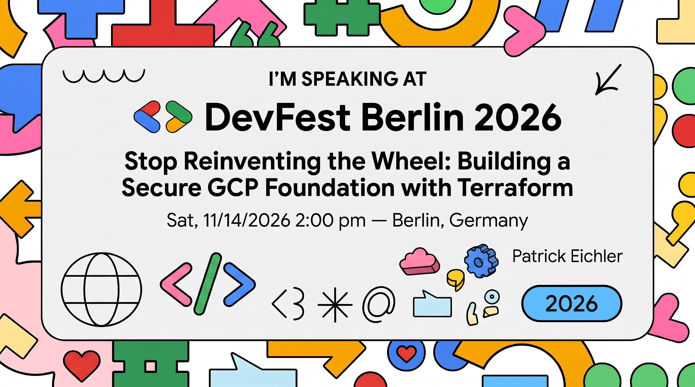

# Stop Reinventing the Wheel: Building a Secure GCP Foundation with Terraform

[](https://2026.devfest-berlin.de/)
[](https://cloud.google.com/)
[](https://www.terraform.io/)
[](https://github.com/terraform-google-modules/terraform-example-foundation)

> **Speaker Session Repository for GDG DevFest Berlin 2026**  
> *Author / Speaker session companion repo exploring enterprise cloud architecture and practical Infrastructure as Code (IaC) on Google Cloud Platform.*

---

Speaker Deck: https://speakerdeck.com/itchimonji

## Session Overview

Many organizations beginning their Google Cloud journey make the mistake of building their cloud foundation from scratch. This "DIY Landing Zone" approach almost always leads to:

- ❌ **Security & Compliance Gaps:** Overprivileged service accounts (`Owner`/`Editor` roles), missing organizational guardrails, and permissive default VPCs.
- ❌ **Blast Radius Exposure:** Monolithic Terraform state files where a single typo can corrupt production alongside development.
- ❌ **Network Chaos:** Inconsistent IP allocations, lack of centralized egress inspection, and unmanaged VPC peering.
- ❌ **High Maintenance Burden:** Reinventing common patterns instead of using verified, community-tested modules.

Google Cloud's [**terraform-example-foundation (TEF)**](https://github.com/terraform-google-modules/terraform-example-foundation)—built on the official **Cloud Foundation Toolkit (CFT)**—solves this by providing an opinionated, production-grade, secure-by-design blueprint.

This repository serves as a **lightweight, practical companion** to the presentation. It breaks down how the foundation works conceptually and shows how application teams deploy real workloads (`app-infra`) on top of it.

---

## How the Terraform Example Foundation Works

The `terraform-example-foundation` organizes enterprise cloud infrastructure into a sequential **multi-stage pipeline**. Each stage has its own dedicated Service Account, Cloud Storage state bucket, and scope of responsibility.

```text
 ┌────────────────────────────────────────────────────────────────────────┐
 │                      0 - BOOTSTRAP (Root of Trust)                     │
 │   • Seed Project & CI/CD Pipelines (Cloud Build / GitHub Actions)      │
 │   • Stage-Specific Service Accounts & Isolated GCS State Buckets       │
 └───────────────────────────────────┬────────────────────────────────────┘
                                     │
 ┌───────────────────────────────────▼────────────────────────────────────┐
 │                    1 - ORG (Organization Guardrails)                   │
 │   • Organization Policies & Constraints (e.g., disable default VPC)    │
 │   • Centralized Audit Logging, Security Command Center (SCC) Sinks     │
 └───────────────────────────────────┬────────────────────────────────────┘
                                     │
 ┌───────────────────────────────────▼────────────────────────────────────┐
 │                    2 - ENVIRONMENTS (Resource Hierarchy)               │
 │   • Environment Folders: Development, Non-Production, Production       │
 │   • Shared Services Folder & Monitoring Workspaces                     │
 └───────────────────────────────────┬────────────────────────────────────┘
                                     │
 ┌───────────────────────────────────▼────────────────────────────────────┐
 │                       3 - NETWORKS (Connectivity)                      │
 │   • Shared VPC Architecture (Hub-and-Spoke / Dual-Hub)                 │
 │   • Cloud NAT, Firewall Policies, Private Google Access, DNS           │
 └───────────────────────────────────┬────────────────────────────────────┘
                                     │
 ┌───────────────────────────────────▼────────────────────────────────────┐
 │                    4 - PROJECTS (Workload Project Vending)             │
 │   • Business Unit & Application Projects (Attached to Shared VPCs)     │
 │   • Service Account Bindings, Cloud KMS Keys, Billing Alerts           │
 └───────────────────────────────────┬────────────────────────────────────┘
                                     │
 ┌───────────────────────────────────▼────────────────────────────────────┐
 │             5 - APP-INFRA (Application Workloads & Services)           │
 │   • The Developer Layer: Cloud Functions, Cloud Run, GKE, Databases    │
 │   • Consumes projects and networks configured in Stages 0–4            │
 └────────────────────────────────────────────────────────────────────────┘
```

### The 5 Stages Explained Simply

| Stage | Name | Role & Responsibility | Key Deliverables |
| :--- | :--- | :--- | :--- |
| **0** | **Bootstrap** | *Who builds the builders?* Establishes the automated CI/CD engine and remote state isolation. | Seed project, stage service accounts, GCS backend buckets, Cloud Build triggers. |
| **1** | **Organization** | *Guardrails and governance.* Applies policies across the entire organization hierarchy. | Org policies (e.g. `restrictVpcPeering`, `enforceUniformBucketLevelAccess`), log sinks. |
| **2** | **Environments** | *Structural isolation.* Creates top-level folders for `development`, `non-production`, and `production`. | Folder hierarchy, tagging, group IAM assignments. |
| **3** | **Networks** | *Zero-trust perimeter.* Builds dedicated Shared VPCs per environment with zero cross-talk by default. | Shared VPC host projects, subnets, Cloud NAT, private service connect, firewall rules. |
| **4** | **Projects** | *Vending workload landing pads.* Creates isolated service projects for specific application teams. | Workload projects, APIs enabled, service accounts, KMS keys, billing budget alerts. |
| **5** | **App Infra** | *Application workloads.* Product teams deploy microservices, databases, and pipelines inside their vended projects. | Cloud Functions, Cloud Run, GKE clusters, Cloud Storage, Spanner/Cloud SQL. |

---

## Core Architectural Pillars

1. **Principle of Least Privilege:**  
   Every stage executes using its own dedicated Google service account (e.g., `sa-terraform-net` can configure VPCs and subnets, but has no permissions to alter organization policies or decrypt KMS keys).
2. **Blast Radius Reduction:**  
   State files are partitioned by stage and environment (`dev`, `nonprod`, `prod`). An issue or lock in a development deployment can never impact production.
3. **Convention over Configuration:**  
   Enforces uniform naming, tagging, region policies, and resource labels across all cloud assets.
4. **Cloud Foundation Toolkit (CFT) Modules:**  
   Instead of writing raw, untested Terraform resources, TEF leverages battle-tested, security-reviewed community modules published by Google (e.g., `terraform-google-modules/cloud-storage/google`).

---

## Repository Structure

This repository models the **Stage 5 (`app-infra`)** pattern, demonstrating how an application team cleanly manages infrastructure across environments while reusing CFT modules:

```text
gdg-devfest-2026-berlin/
├── README.md                      # Presentation guide and documentation
├── .gemini/skills/google-skills   # Google Skills submodule for Gemini CLI assistance
└── examples/
    └── cloud-function/            # Sample application workload
        ├── envs/
        │   ├── development/       # Development environment configuration
        │   │   ├── backend.tf     # Environment-specific state configuration
        │   │   ├── main.tf        # Environment composition & parameter values
        │   │   ├── outputs.tf     # Environment outputs
        │   │   └── versions.tf    # Terraform & provider constraints
        │   └── production/        # Production environment configuration
        │       ├── backend.tf
        │       ├── main.tf
        │       ├── outputs.tf
        │       └── versions.tf
        └── modules/
            ├── bucket/            # Reusable wrapper for Cloud Storage CFT module
            │   ├── iam.tf
            │   ├── main.tf
            │   ├── outputs.tf
            │   ├── services.tf    # Automated API enablement
            │   └── variables.tf
            └── cloud_function/    # Reusable wrapper for Scheduled Function CFT module
                ├── function_source/
                │   ├── Dockerfile       # Portable container image definition
                │   ├── main.py          # Pub/Sub event handler writing data & assets
                │   └── requirements.txt
                ├── iam.tf
                ├── main.tf
                ├── outputs.tf
                ├── services.tf    # Automated API enablement
                └── variables.tf
```

---

## What the Cloud Function Does (Workload Logic)

The sample workload deployed by this repository models a production-grade, scheduled event-driven ingestion service. Here is how it operates from trigger to completion:

```text
  [ Cloud Scheduler ]
          │ (Publishes message on schedule)
          ▼
  [ Cloud Pub/Sub Topic ]
          │ (Triggers event execution)
          ▼
  [ Cloud Function: fn-... ] (Runs main.py as sa-...-fn-dev)
          │
          ├── 1. Decodes incoming Pub/Sub trigger payload
          ├── 2. Generates unique execution ID & ISO 8601 timestamp
          │
          ├── 3. Writes Telemetry JSON Record ───> gs://bkt-.../records/<env>/<timestamp>-<id>.json
          │      • Status: success
          │      • Environment: development / production
          │      • Event: gdg-devfest-2026-berlin
          │      • Message payload: string
          │
          ├── 4. Writes SVG Image Asset ─────────> gs://bkt-.../images/<env>/<timestamp>-<id>.svg
          │      • Branded vector badge with event name, env, & run ID
          │      • Validates binary/graphic asset storage
          │
          └── 5. Emits URIs & Execution Metrics to Google Cloud Logging
```

### Key Highlights for Your Speaker Session:
1. **Multi-Service Architecture:** Demonstrates how multiple Google Cloud components (Scheduler, Pub/Sub, Functions, Cloud Storage) integrate seamlessly using CFT modules.
2. **True Least-Privilege IAM:** The function executes under a dedicated service account (`sa-datacenter-1-fn-dev`) granted only `roles/storage.objectUser` on the target bucket—it cannot access other buckets or project services.
3. **Dual-Asset Verification:** Rather than just printing "Hello World", it creates verifiable structured data (`.json`) AND an open-source visual asset (`.svg`), giving attendees immediate visual confirmation during a live demo.

---

## Getting Started

### Prerequisites

- [Terraform](https://developer.hashicorp.com/terraform/downloads) `>= 1.5.0`
- [Google Cloud SDK (`gcloud`)](https://cloud.google.com/sdk/docs/install) authenticated (`gcloud auth application-default login`)
- A Google Cloud Project (e.g. `gdg-devfest-demo-dev`)
- (Optional) [Gemini CLI](https://github.com/google-gemini/gemini-cli) for AI-driven IaC authoring

### 1. Clone Repository and Submodules

Clone this repository and recursively pull the included Google developer skills:

```bash
# Clone via SSH
git clone git@github.com:Itchimonji/gdg-devfest-2026-berlin.git
cd gdg-devfest-2026-berlin

# Or clone via HTTPS
git clone https://github.com/Itchimonji/gdg-devfest-2026-berlin.git
cd gdg-devfest-2026-berlin

# Initialize and update submodules (Google Skills)
git submodule update --init --recursive
```

### 2. Inspect an Environment

Navigate to the development environment configuration:

```bash
cd examples/cloud-function/envs/development
```

Review how the environment specifies local context and invokes modular infrastructure:

```hcl
locals {
  # Core project identifier: adapted by modules to "gdg-devfest-demo-dev"
  project_id        = "gdg-devfest-demo"
  business_unit     = "datacenter_1"
  environment       = "development"
  environment_short = "dev"
  default_region    = "europe-west3"
}

module "bucket" {
  source = "../../modules/bucket"

  project_id    = local.project_id
  environment   = local.environment
  business_unit = local.business_unit
  env_short     = local.environment_short
  region        = local.default_region
}

module "cloud_function" {
  source = "../../modules/cloud_function"

  project_id    = local.project_id
  environment   = local.environment
  business_unit = local.business_unit
  env_short     = local.environment_short
  region        = local.default_region
  bucket_name   = module.bucket.bucket_name
}
```

### 3. Deploy Infrastructure

```bash
# Initialize providers and CFT modules
terraform init

# Validate configuration syntax and provider requirements
terraform validate

# Plan deployment (automatically targets gdg-devfest-demo-dev)
terraform plan

# Apply the configuration
terraform apply
```

---

## Testing & Verifying the Pipeline (Live Demo Walkthrough)

Once `terraform apply` completes, verify the automated scheduled pipeline end-to-end:

### Step 1: Export Outputs

In `examples/cloud-function/envs/development`, capture the generated resource names:

```bash
BUCKET_NAME=$(terraform output -raw bucket_name)
SCHEDULER_JOB=$(terraform output -raw scheduler_job_name)
TOPIC_NAME=$(terraform output -raw pubsub_topic_name)
PROJECT_ID=$(terraform output -raw project_id)

echo "Project:   $PROJECT_ID"
echo "Bucket:    $BUCKET_NAME"
echo "Job:       $SCHEDULER_JOB"
echo "Topic:     $TOPIC_NAME"
```

### Step 2: Trigger the Pipeline

Instead of waiting for the cron schedule, trigger an immediate execution using either approach:

- **Option A: Trigger the Cloud Scheduler Job (Recommended)**
  Simulates the cron trigger:
  ```bash
  gcloud scheduler jobs run "$SCHEDULER_JOB" \
    --location=europe-west3 \
    --project="$PROJECT_ID"
  ```

- **Option B: Publish directly to the Pub/Sub Topic**
  Tests event-driven invocation:
  ```bash
  gcloud pubsub topics publish "$TOPIC_NAME" \
    --message="Live test from GDG DevFest Berlin 2026!" \
    --project="$PROJECT_ID"
  ```

### Step 3: Inspect the Generated Data & Image Assets

The function stores both a structured JSON record and an open-source SVG image into the bucket:

1. **List files in Cloud Storage:**
   ```bash
   gcloud storage ls --recursive "gs://$BUCKET_NAME/"
   ```
   *Output will show files organized by environment:*
   ```text
   gs://<bucket>/images/development/2026-11-13T...-a1b2c3d4.svg
   gs://<bucket>/records/development/2026-11-13T...-a1b2c3d4.json
   ```

2. **Read the latest JSON record:**
   ```bash
   LATEST_JSON=$(gcloud storage ls "gs://$BUCKET_NAME/records/development/*.json" | tail -n 1)
   gcloud storage cat "$LATEST_JSON"
   ```

3. **Inspect the SVG image asset:**
   ```bash
   LATEST_SVG=$(gcloud storage ls "gs://$BUCKET_NAME/images/development/*.svg" | tail -n 1)
   gcloud storage cat "$LATEST_SVG"
   ```

### Step 4: Stream Cloud Function Logs

Observe function execution, Pub/Sub message reception, and storage writes in real time:

```bash
gcloud functions logs read fn-datacenter-1-dev \
  --region=europe-west3 \
  --project="$PROJECT_ID" \
  --limit=25
```

---

## Cleanup & Cost Protection (Teardown)

To avoid recurring Google Cloud charges after testing or presenting, tear down the provisioned infrastructure:

```bash
# Navigate to the environment you deployed
cd examples/cloud-function/envs/development

# (Optional) Empty objects in the destination bucket if needed
BUCKET_NAME=$(terraform output -raw bucket_name)
gcloud storage rm --recursive "gs://$BUCKET_NAME/**"

# Destroy all provisioned resources
terraform destroy
```

> **Note on Cost Protection:** Cloud Functions and Cloud Storage in this demo fall well within the [Google Cloud Free Tier](https://cloud.google.com/free) (first 2M Cloud Function invocations/month and 5GB GCS storage are free). However, running `terraform destroy` ensures no Cloud Scheduler or telemetry artifacts linger after your session.

---

## Enhancing IaC with Gemini CLI & Google Skills

Modern cloud engineering is accelerated with AI developer assistants. This repository integrates official [Google Cloud Skills](https://github.com/google/skills) via Git submodules to work with the **Gemini CLI**.

### Why Use Gemini CLI with Google Skills?

- **Architecture & Pattern Lookup:** Instantly query best practices for Cloud Run, Cloud Functions, and VPC SC directly in your terminal.
-  **IAM Least Privilege Checks:** Analyze Terraform IAM bindings before running `terraform apply`.
- **Rapid Module Scaffolding:** Generate CFT-compliant Terraform modules that follow Google's Cloud Foundation standards.

### Installation & Usage

Install the Gemini CLI:

```bash
npm install -g @google/gemini-cli
```

Once installed, Gemini CLI automatically recognizes skills located under `.gemini/skills/` to provide grounded, expert guidance on Google Cloud and Terraform architecture.

---

## Essential References & Further Reading

- [terraform-example-foundation (GitHub)](https://github.com/terraform-google-modules/terraform-example-foundation) - The official Google Cloud blueprint repository.
- [Cloud Foundation Toolkit (CFT)](https://cloud.google.com/foundation-toolkit) - Google Cloud's official collection of modular IaC components.
- [Google Cloud Architecture Framework](https://cloud.google.com/architecture/framework) - Best practices for security, reliability, cost optimization, and operational excellence.
- [Google Skills Repository](https://github.com/google/skills) - Curated skills for agentic developer workflows.
- [Gemini CLI](https://github.com/google-gemini/gemini-cli) - AI-powered CLI tool for developers.

---

## Community & Feedback

Presented at **GDG DevFest Berlin 2026**. Feel free to fork, experiment, open issues, or submit PRs with questions or suggestions!
